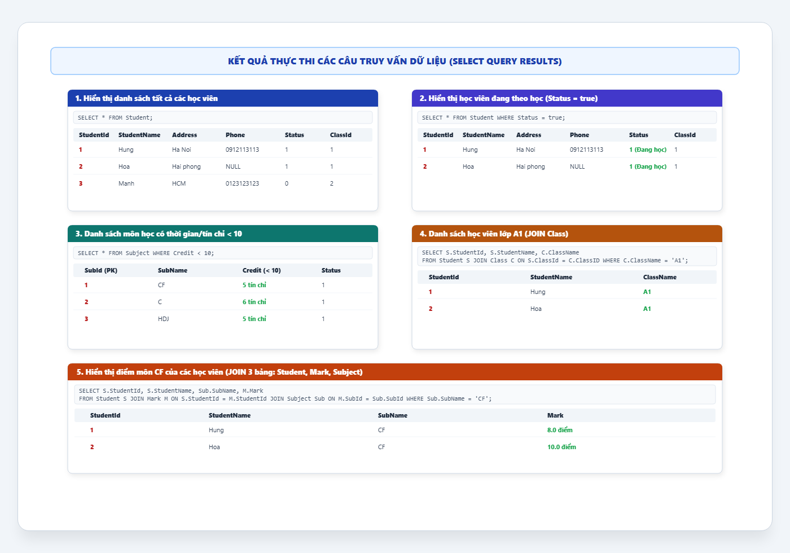

# [THỰC HÀNH] TRUY VẤN DỮ LIỆU TỪ NHIỀU BẢNG TRONG MYSQL (QuanLySinhVien)

- **Mục tiêu:** Sử dụng thành thạo các câu lệnh truy vấn dữ liệu trong MySQL: `SELECT`, mệnh đề lọc điều kiện `WHERE`, và phép kết nối dữ liệu nhiều bảng `INNER JOIN ... ON`.
- **Cơ sở dữ liệu:** `QuanLySinhVien`
- **Sinh viên thực hiện:** DTC245200413 (`dtc245200413-cmyk`)
- **Repository:** [https://github.com/dtc245200413-cmyk/jwbd-2023-sql-student-management-select-query](https://github.com/dtc245200413-cmyk/jwbd-2023-sql-student-management-select-query)
- **Mã nguồn tham khảo:** [https://github.com/codegym-vn/jwbd-2023-sql-student-management-select-query](https://github.com/codegym-vn/jwbd-2023-sql-student-management-select-query) (nhánh `dev`)

---

## 1. KẾT QUẢ THỰC THI 5 CÂU TRUY VẤN TRỰC QUAN



---

## 2. CHI TIẾT CÁC BƯỚC VÀ CÂU LỆNH TRUY VẤN SQL

### Bước 1: Chọn Database `QuanLySinhVien` để làm việc
```sql
USE QuanLySinhVien;
```

---

### Bước 2: Hiển thị danh sách tất cả các học viên
* **Yêu cầu:** Lấy toàn bộ thông tin học sinh từ bảng `Student`.
```sql
SELECT * 
FROM Student;
```
* **Kết quả:** Trả về tất cả 3 học viên (`Hung`, `Hoa`, `Manh`).

---

### Bước 3: Hiển thị danh sách các học viên đang theo học
* **Yêu cầu:** Lọc các học viên có `Status = true` (hoặc `Status = 1`).
```sql
SELECT * 
FROM Student 
WHERE Status = true;
```
* **Kết quả:** Trả về 2 học viên đang theo học là `Hung` và `Hoa` (loại bỏ `Manh` có `Status = 0`).

---

### Bước 4: Hiển thị danh sách các môn học có thời gian học / số tín chỉ nhỏ hơn 10
* **Yêu cầu:** Lọc các môn học trong bảng `Subject` có `Credit < 10`.
```sql
SELECT * 
FROM Subject 
WHERE Credit < 10;
```
* **Kết quả:** Trả về 3 môn học: `CF` (5 tín chỉ), `C` (6 tín chỉ), `HDJ` (5 tín chỉ). Loại môn `RDBMS` (10 tín chỉ).

---

### Bước 5: Hiển thị danh sách học viên lớp A1 (JOIN 2 bảng)
* **Yêu cầu:** Kết hợp bảng `Student` và bảng `Class` thông qua khóa ngoại `ClassId = ClassID` và lọc điều kiện `ClassName = 'A1'`.
```sql
SELECT S.StudentId, S.StudentName, C.ClassName
FROM Student S 
JOIN Class C ON S.ClassId = C.ClassID
WHERE C.ClassName = 'A1';
```
* **Kết quả:** Trả về 2 học viên thuộc lớp A1 là `Hung` và `Hoa`.

---

### Bước 6: Hiển thị điểm môn CF của các học viên (JOIN 3 bảng)
* **Yêu cầu:** Kết hợp 3 bảng `Student`, `Mark` và `Subject` để lấy tên học viên, tên môn và điểm số môn `CF`.
```sql
SELECT S.StudentId, S.StudentName, Sub.SubName, M.Mark
FROM Student S 
JOIN Mark M ON S.StudentId = M.StudentId 
JOIN Subject Sub ON M.SubId = Sub.SubId
WHERE Sub.SubName = 'CF';
```
* **Kết quả:**
  * Học viên `Hung`: Môn `CF` đạt `8.0` điểm.
  * Học viên `Hoa`: Môn `CF` đạt `10.0` điểm.

---

## 3. CÁC TỆP MÃ NGUỒN TRONG REPOSITORY
* [`select-query.sql`](select-query.sql): Toàn bộ 5 câu truy vấn `SELECT` chuẩn theo đúng yêu cầu đề bài.
* [`insert-into.sql`](insert-into.sql): Dữ liệu mẫu `INSERT INTO` của bài học trước để tạo dữ liệu kiểm chứng.
* [`QuanLySinhVien.sql`](QuanLySinhVien.sql): Cấu trúc bảng CSDL `QuanLySinhVien`.
* [`assets/query_results_preview.png`](assets/query_results_preview.png): Ảnh chụp đồ họa kết quả của từng câu truy vấn.

---

## 4. LINK NỘP BÀI
- **GitHub Repository:** [https://github.com/dtc245200413-cmyk/jwbd-2023-sql-student-management-select-query](https://github.com/dtc245200413-cmyk/jwbd-2023-sql-student-management-select-query)
